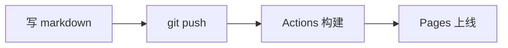

这一页是写给自己的说明书 —— 过三个月忘了怎么写提示框，回来看这里就行。

## 提示框

```

正文，支持 markdown

```

四种颜色：


这是个 note，蓝色。适合补充一句背景。



这是个 tip，绿色。适合写"其实有更简单的办法"。



这是个 warning，橙色。适合写"这里容易踩坑"。



这是个 danger，红色。适合写"干了就会出事"。


## 折叠

```

藏在里面的内容

```


里面可以放任何东西，包括代码块和列表。

- 一
- 二


## 公式

只要在这篇文章的 front matter 里写 `math: true`，然后：

行内：$E = mc^2$，块级：

$$
\int_{-\infty}^{\infty} e^{-x^2}\,dx = \sqrt{\pi}
$$

## 图表

用 mermaid 代码块：



## 嵌入视频

B 站（填 BV 号）：

```

```



YouTube（填视频 ID）：

```

```



## 音乐播放器

每行一首，格式 `曲名 | 音频直链`：

```

SoundHelix 1 | https://www.soundhelix.com/examples/mp3/SoundHelix-Song-1.mp3
SoundHelix 2 | https://www.soundhelix.com/examples/mp3/SoundHelix-Song-2.mp3

```


SoundHelix 1 | https://www.soundhelix.com/examples/mp3/SoundHelix-Song-1.mp3
SoundHelix 2 | https://www.soundhelix.com/examples/mp3/SoundHelix-Song-2.mp3


## 天气

```

```



## 键盘按键

用 `<kbd>` 包起来：<kbd>Ctrl</kbd> + <kbd>K</kbd> 打开搜索，<kbd>Esc</kbd> 关掉。

## 还有几个不在这页的

- **相册**：图片丢进 `content/gallery/`，页面里写 ``
- **友链**：`content/links.md` 里用 ``，每行 `名字 | 链接 | 描述`
- **微语**：`content/moments/` 下新建 md，比文章更随意
- **用 Issue 发文章**：仓库里开个 issue，打个 `post` 标签，正文就是文章内容
